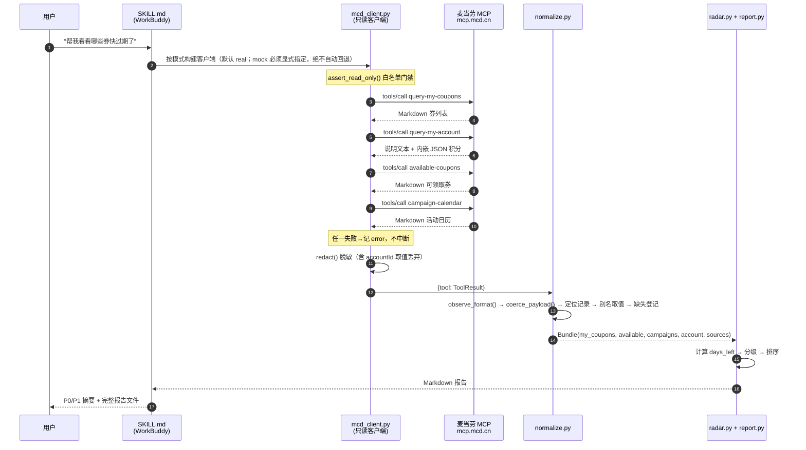

# MCP 集成说明 · super-mcd-benefits-radar（超麦权益雷达）

本文说明本项目**实际使用了哪个 MCP Server、哪些 Tool、调用流程如何、业务价值在哪里**。

> 📌 **数据边界**：本文引用的响应**格式**来自 2026-10-09 的真实调用；
> 但**真实响应正文含账户数据（券清单、积分余额），未随公开仓库分发**。
> 仓库内 `fixtures/` 是**结构逐行对标真实响应、取值全部合成**的样例。
> 格式结论与被修复的缺陷见 [`references/live-verification.md`](references/live-verification.md)，
> 隐私边界见 [`references/privacy-and-publication.md`](references/privacy-and-publication.md)。

---

## 1. 使用的 MCP Server

| 项 | 值 |
|---|---|
| 服务方 | 麦当劳中国（官方远程托管） |
| 接入地址 | `https://mcp.mcd.cn` |
| 传输协议 | Streamable HTTP |
| 鉴权 | 请求头 `Authorization: Bearer YOUR_MCP_TOKEN` |
| Token 申请 | <https://open.mcd.cn/mcp> |
| 官方文档 | <https://github.com/M-China/mcd-mcp-server> |
| 限流 | 600 请求/分钟/Token，超出返回 `429` |
| 收费 | 免费 |

端点在 `scripts/verify_mcp.py` 中做了**不带 Token 的握手探测**：返回 `403` 且响应体为
麦当劳统一错误信封（`{"code":"0001","msg":"系统错误","data":null}`），
证实是受鉴权保护的官方服务，而非 DNS 占位或镜像站点。

### 两种接入方式

| 方式 | Token 在哪 | 本项目如何取数 | 适用场景 |
|---|---|---|---|
| **A. WorkBuddy 连接器**（推荐） | WorkBuddy 凭据库（进程外） | WorkBuddy 原生调度四个只读工具，把返回写入回放目录 → `--mode replay` | 在 WorkBuddy 会话中使用 |
| B. 环境变量 | 进程环境 `MCD_MCP_TOKEN` | `--mode real` 由 Python 直接联网 | 本地命令行 / CI |

方式 A 下端到端链路与方式 B **完全相同**（同一套解析、排序、渲染代码），
差别只在"谁发起 HTTP 请求"。方式 A 是本项目在 WorkBuddy 中的推荐路径，
因为它不需要用户把 Token 从连接器里再掏出来一次。

## 2. 使用的 Tools（共 4 个，全部为只读查询）

工具名取自官方仓库 `README.md` 的工具列表（版本日志最新条目 v1.0.9 / 2026-09-10）。

| # | 工具名 | 官方名称 | 取什么 | 实测返回格式 | 在报告中的位置 |
|:---:|---|---|---|---|---|
| 1 | `query-my-coupons` | 我的优惠券查询 | 我账户下已有的券列表 | Markdown | 第 2–4 节（**报告主体**） |
| 2 | `query-my-account` | 我的积分查询 | 可用/累计/冻结/即将过期积分 | 说明文本 + 内嵌 JSON | 第 5 节「积分账户」 |
| 3 | `available-coupons` | 麦麦省券列表查询 | 当前**可领取**的券 | Markdown | 第 7 节「待领取」（只提示，不代领） |
| 4 | `campaign-calendar` | 活动日历查询工具 | 当月活动（进行中/往期/未来） | Markdown | 第 6 节「活动日历」 |

「实测返回格式」一栏由真实调用得出，由 `normalize.observe_format()` 程序判定，
并非人工声称；四种格式的基准样例见 `fixtures/`（**结构逐行对标真实响应，取值全部合成**）。

辅助：`now-time-info`（获取当前时间信息）在只读白名单内，用于在必要时校准"今天"。
默认以本地系统时间为基准日，可用 `--today YYYY-MM-DD` 覆盖以便复现历史报告。

### 未使用的 Tools 及原因

官方清单中还有约 30 个工具（点餐、下单、积分兑换、抽奖、派对预约等）。
本项目**一个都不用**，因为在代码层被白名单挡下：

| 未使用 | 原因 |
|---|---|
| `auto-bind-coupons` | 会改变账户权益状态，属"自动领券"，违反只读原则 |
| `mcdelivery-order` / `pickup-order` / `group-meal-order` / `party-order-create` | 产生真实消费 |
| `mall-create-order` / `point-redemption` | 消耗积分资产 |
| `draw-lottery` | 消耗积分或抽奖次数 |
| 门店/菜单/营养/订单查询类 | 与"权益到期管理"这一目标无关，纳入只会稀释报告焦点 |

> 拦截机制是 **白名单 + 默认拒绝**（`scripts/mcd_client.py` 的 `READ_ONLY_TOOLS` /
> `assert_read_only`），而非黑名单。官方新增任何写入类工具都会被自动拦下。

## 3. 调用流程



> 图中标注的返回格式全部来自**真实调用实测**（2026-10-09），不是推测。
> 四个工具**没有一个是纯 JSON**。

调用为**顺序执行**、每条都是独立的 `tools/call`，总请求数 **4 次**，
远低于 600 次/分钟的限流阈值。

> ⚠️ **默认真实模式，且绝不自动回退 `mock`。** 没有 `MCD_MCP_TOKEN` 时，
> `--mode real` 会直接报错并以退出码 `2` 结束，而**不会**悄悄换成合成样例——
> 否则用户会拿到一份看起来正常的假报告，却误以为是自己账户的真实权益。
> `mock` 只能由用户显式指定，报告首行与终端都会标注"合成样例、非真实权益"。
>
> 连接器场景下，四个工具的原始返回需先**逐字落盘**再用 `--mode replay` 回放；
> 落盘后请先用 `scripts/verify_capture.py` 校验（缺件 / 读不懂 / 疑似被转述一律拦下）。

## 4. 数据处理链路

```
MCP 原始返回（dict / 纯 JSON 文本 / 说明文本包裹 JSON / Markdown）
    │  ⓪ 状态判定：classify_state() —— 先分清"空 / 读不懂 / 失败"，再谈解析
    ▼
    ├── 调用失败 ──────────────────────────────► FAILED   → "取数失败 + 原因"
    ├── 成功且有内容 + 解析出记录 ──────────────► PARSED   → 正常展示
    ├── 成功、有内容、却零记录 ─────────────────► UNRECOGNIZED
    │        （必须报"收到数据，但解析失败"，禁止说"没有数据"）
    └── 成功且确实为空 ────────────────────────► EMPTY    → 才可以说"没有"
    │
    │  ① 规范化载荷：coerce_payload()
    │       dict/list 原样 → 纯 JSON 文本解析 → 内嵌 JSON 提取 → 文本原样
    │      内嵌 JSON 用 extract_embedded_json() 逐字符配平大括号定位
    │      （query-my-account 的 JSON 外面裹着字段说明，必须靠配平而非关键字切分）
    │      observe_format() 由程序判定：json / json（内嵌于说明文本）/ markdown / text / empty
    ▼
    │  ② 定位：find_records() 递归寻找记录数组
    │     取不到记录且该工具已注册文本解析器 → 回退 _TEXT_PARSERS
    │     （query-my-coupons / available-coupons / campaign-calendar 三份 Markdown）
    ▼
记录 dict（JSON 与 Markdown 两条路径在此汇合）
    │  ③ 映射：COUPON_ALIASES / CAMPAIGN_ALIASES / POINTS_ALIASES 逐个别名试取
    │     券的必需字段集按来源分流（"我的券" ≠ "可领取券"），避免虚报缺失
    ▼
规范化对象（Coupon / Campaign / PointsAccount）
    │  ④ 校验：取不到 → None + 记入 missing（绝不填默认值）
    │     并按 source_format 决定标记措辞：取不到 = [字段缺失]；格式不含 = 未提供
    ▼
Bundle（含 SourceStatus 数据源状态表 + integrity_notes + parse_notes + absent_fields）
    │  ⑤ 计算：days_left = (valid_to - today_beijing()).days   ← 纯 stdlib datetime
    │       活动按来源分流：JSON → 有效期紧急度；Markdown → 日历语义（TODAY/UPCOMING/PAST）
    ▼
Assessment（level / days_left / reason / value）
    │  ⑥ 排序：(等级序, 剩余天数升序, 优惠值降序, 名称升序)
    ▼
Markdown 报告（8 节固定结构 + 完整性声明）
```

### 实测发现：四个工具返回三种格式

2026-10-09 对四个只读工具的**真实调用**显示，它们的返回格式互不相同，
其中只有一个是内嵌 JSON：

| 工具 | 实测格式 | 处理方式 | 解析结果 |
|---|---|---|---|
| `query-my-coupons` | Markdown（`## 券名` + `- **字段**: 值`） | `parse_coupon_markdown()` | 14/14 |
| `query-my-account` | 说明性文本 + 内嵌 JSON | `extract_embedded_json()` | 1/1 |
| `available-coupons` | Markdown（行尾 `\` 续行） | `parse_available_coupons_markdown()` | 9/9 |
| `campaign-calendar` | Markdown（`#### 日期` 分组） | `parse_campaign_markdown()` | 30/30 |

三份 Markdown 解析器都产出与 `*_ALIASES` 对齐的记录字典，
**因此 JSON 与 Markdown 共享同一套归一化、排序与渲染逻辑**
（两条路径只有一份实现，不存在"JSON 能排序、Markdown 不能"的裂缝）。

格式基准样例见 `fixtures/query_my_coupons.md`、`fixtures/query_my_account.txt`、
`fixtures/available_coupons.md`、`fixtures/campaign_calendar.md`
（**结构逐行对标真实响应，取值全部为合成值**，真实响应含账户数据不随仓库分发）；
验证过程见 [`references/live-verification.md`](references/live-verification.md)。

> 活动日历修复前：Markdown 格式导致解析器零产出，报告显示"本月没有活动"且无任何提示。
> 修复后：30 条活动 / 12 个日期分组全部还原，且不再使用"到期/结束"等编造措辞。

### 为什么要有 ③④ 两层

官方仓库只给出工具**用途描述**，未公开响应字段级 schema。
因此本项目不硬编码字段名，而是：

1. 每个规范字段配一组**别名**（如到期日 = `endDate` / `validTo` / `expireTime` / …）；
2. 全部落空时**登记为缺失**，报告渲染 `[字段缺失]`（格式本身不含该字段则渲染 `未提供`）；
3. 报告第 8 节自动列出"尚未被规范化映射的顶层字段"，作为收敛别名表的线索。

这套做法的意义是：**schema 猜错时，输出会难看，但不会撒谎。**
详见 [`references/data-schema.md`](references/data-schema.md)（由代码自动生成，不会与实现漂移）。

### 为什么"解析失败"必须独立成一个状态

只记录"解析出几条记录"的做法有一个致命盲区：**解析器读不懂真实格式**与
**接口确实返回空**在报告里长得一模一样，都显示"没有数据"。
用户看到"本月没有活动"会认为确实没有，而真相是程序没读懂——
这是**静默的假阴性**，比报错更危险，因为无从察觉。

因此把状态显式拆成四种，并规定只有 `EMPTY` 才允许下"没有数据"的结论。
该约束由 `tests/test_payload_state.py` 的专项用例锁定，防止回归。

判定 `EMPTY` 时用的是 `_is_effectively_empty()`：**先跳过标题行与计数声明，
仍无内容才算真空**。这样 `### 麦麦省优惠券列表：` 这种"只有标题"的返回会被正确判为
空结果，而不是"解析失败"——否则用户会以为接口坏了。

同理，仅含协议信封（`{"code":0,"success":true,…}`）而不含任何积分字段的返回
**不算**"有数据"；否则报告会列出一屏 `[字段缺失]`，读起来也像接口坏了。

## 5. 业务价值

| 价值 | 具体体现 |
|---|---|
| **止损**。把券的过期损失变成可见的数字 | 每张券按剩余天数分级，P0/P1 置顶，最容易被忽略的"今天到期"排第一 |
| **排序代替罗列**。App 给的是"列表"，本项目给的是"顺序" | 报告直接回答"先做什么"，而不只是"有什么" |
| **跨源去重**。避免重复提醒 | 已在「我的券」中的可领取券被标记，不再重复推荐 |
| **把"不知道"显式化** | 缺到期日的券不做静默丢弃、也不假设永久有效，单列 UNKNOWN 提醒用户自查 |
| **把"不敢做"显式化** | 不代领券、不下单，只给排序与建议；把执行权留给人 |
| **把"读不懂"显式化** | 四个工具返回三种格式，解析失败必报警，绝不把"没读懂"伪装成"没有数据" |
| **绝不静默造假** | 默认即真实 MCP；没有 Token 或取数失败时直接报错退出，绝不自动回退到合成样例 |
| **零依赖可审计** | 纯标准库 + 337 项测试，评委与用户可完整复核逻辑 |

一句话：**它不替用户花钱，只替用户记事。**

## 6. 错误处理与降级

| 情况 | HTTP / 现象 | 处理 |
|---|---|---|
| Token 无效或缺失 | `401` | 抛 `MCPAuthError`，CLI 以退出码 `2` 结束并打印申请指引；**不抛裸异常** |
| 触发限流 | `429` | 抛 `MCPRateLimitError`，提示降低频率 |
| 网络不可达 / 非 JSON 响应 | — | 抛 `MCPTransportError`，错误文本经脱敏 |
| 单个工具取数失败 | `FAILED` | **不中断**：记录原因，报告对应板块写"数据获取失败 + 原因"，其余照常生成 |
| 响应有内容但解析不出记录 | `UNRECOGNIZED` | 报告写"**收到数据，但解析失败**"并给出排查命令；**禁止**呈现为"没有数据" |
| 响应确实为空 | `EMPTY` | 这是**唯一**允许说"没有活动 / 没有券"的情况 |
| 全部工具均失败 | — | CLI 返回退出码 `1`，便于 CI 感知 |
| 有工具"收到数据但解析失败" | `UNRECOGNIZED` | CLI 返回退出码 `3`，并在 stderr 提示"该板块的空白不代表没有权益" |
| 试图调用写入类工具 | — | `WriteOperationBlocked`，`ToolResult.blocked = True`，不发请求 |
| 响应是 SSE 或纯 JSON | — | 两种形态都能解析（`text/event-stream` 的 `data:` 帧 / 直接 JSON） |
| 响应是 Markdown 正文 | — | 该工具已注册文本解析器（`query-my-coupons` / `available-coupons` / `campaign-calendar`）则回退解析；否则记为 `UNRECOGNIZED` |
| 响应是"说明文本包裹的 JSON" | — | `extract_embedded_json()` 靠括号配平定位并提取；提取失败记 `UNRECOGNIZED`，不猜 |
| 返回仅含协议信封（`code`/`success`/`msg`） | — | 视为"无有效数据"，不列出满屏 `[字段缺失]` |
| Markdown 中个别条目缺标题 / 日期分组无条目 | — | 记入 `Bundle.parse_notes`，在报告第 8 节列出，**不静默丢弃** |
| 返回含账号标识（`accountId`） | — | 归一化时即丢弃取值，只记录"字段存在过"；不进报告、不进日志、不进 `--dump-raw` |
| 图片 URL 携带签名参数（`q-ak=` / `q-signature=`） | — | 视为有时效凭据，`mask_sensitive()` 掩码 |

## 7. 复现与验证

```bash
# 1) 离线自检（不需要 Token）
python scripts/verify_mcp.py

# 2) 端点到真实服务器比对工具清单
MCD_MCP_TOKEN=*** python scripts/verify_mcp.py --real

# 3) 离线复现官方响应格式（不需要 Token）
python scripts/run_radar.py --mode replay --replay-dir fixtures --out report.md
#    fixtures/ 存的是结构逐行对标 2026-10-09 真实响应的合成样例（取值全部合成），
#    走的是与联网完全相同的解析/排序/渲染链路

# 3b) 校验自采目录（WorkBuddy 连接器场景的硬门槛）
python scripts/verify_capture.py --dir fixtures-dump/
#    退出码 0 才可进入报告生成；缺件 / 解析失败 / 疑似被转述都会以非 0 退出

# 4) 联网取数并导出原始返回，用于校准字段映射
MCD_MCP_TOKEN=*** python scripts/run_radar.py --mode real --dump-raw raw/
#    然后对照 report.md 第 8 节的"未映射顶层字段"与 raw/ 里的原始返回
#    （注意：此路径需进程可见的 MCD_MCP_TOKEN，WorkBuddy 连接器场景请走步骤 3）

# 5) 回归测试
python run_tests.py
```

### 已验证 / 未验证（截至 2026-10-09）

四个工具的**真实响应格式均已实测确认**，真实格式的解析率均为 100%：

| 工具 | 真实响应格式 | 已实测解析率 | 字段映射 |
|---|---|:---:|---|
| `query-my-coupons` | ✅ Markdown | 14/14 = 100% | ✅ 已按真实响应实现 |
| `query-my-account` | ✅ 说明文本 + 内嵌 JSON | 1/1 = 100% | ✅ 已按真实响应实现（含 `Mouth` 拼写） |
| `available-coupons` | ✅ Markdown（行尾 `\`） | 9/9 = 100% | ✅ 已按真实响应实现 |
| `campaign-calendar` | ✅ Markdown（`#### 日期` 分组） | 30/30 = 100% | ✅ 已按真实响应实现（30 条 / 12 分组无遗漏） |

**但这仍是单次快照（2026-10-09）。** 官方字段名随券类型与活动配置浮动：
本项目对已出现的字段做了映射，对**未出现过的字段**只能保留为"未映射"并在报告第 8 节列出。
拿到新 Token 后建议再跑一次 `--dump-raw`（或 replay 一份新快照）收敛别名表。
**在补充验证之前，别名表对"新出现的字段"仍属假设。**

> 与第一轮的差别：第一轮只有 `campaign-calendar` 完成验证，另外三个工具是
> "基于用途描述的假设别名"。本轮通过真实调用补齐了这三个工具的格式确认与字段核对，
> 因此上表的 ❓ 全部转为 ✅（快照范围）。

## 8. 合规与免责

- 使用的工具均为只读查询；**未调用任何下单、领券、积分兑换、抽奖类工具**。
- 遵守麦当劳中国《使用条款》及《麦当劳 MCP 服务规则》；仅将 MCP 返回用于本工具展示，
  不做二次分发、不用于商业售卖或引流变现。
- 本项目为参赛作品，**非麦当劳官方产品**；输出仅供参考，
  券面规则、价格与供应状态以麦当劳官方渠道的实时结果为准。
